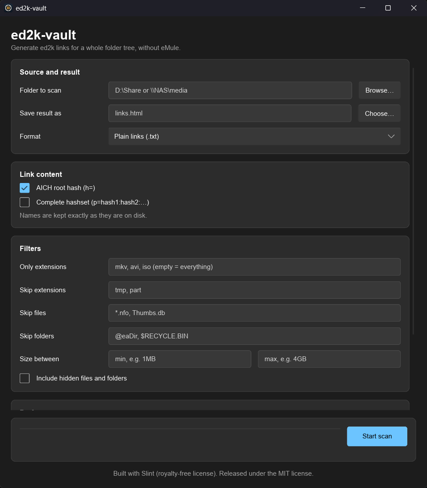
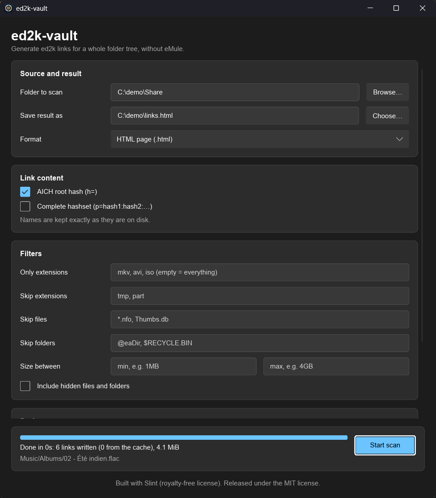

<p align="center"></p>

# ed2k-vault

Génère des liens ed2k pour toute une arborescence, **sans eMule**. Pointez un dossier (local, disque externe, NAS/UNC) et récupérez vos fichiers sous forme de liens nommés exactement comme sur le disque : une mini-sauvegarde personnelle à relancer dans eMule après un sinistre.

[English version](README.md)

## Démarrage rapide (sans connaissances techniques)

1. Ouvrez la section **Releases** à droite de la page GitHub et cliquez sur la dernière version.
2. Dans **Assets**, téléchargez l'archive correspondant à votre système :
   - Windows : `ed2k-vault-vX.Y.Z-x86_64-pc-windows-msvc.zip`
   - Linux : `ed2k-vault-vX.Y.Z-x86_64-unknown-linux-gnu.tar.gz`
   - Mac avec puce Apple (M1 et suivants) : `...aarch64-apple-darwin.tar.gz`
   - Mac avec puce Intel : `...x86_64-apple-darwin.tar.gz`
3. Décompressez l'archive où vous voulez (rien à installer).
4. Double-cliquez sur **`ed2k-vault-gui.exe`** (sous Linux et Mac, lancez `ed2k-vault-gui`). Windows peut prévenir que le programme n'est pas signé : cliquez sur *Informations complémentaires*, puis *Exécuter quand même*.
5. Cliquez sur **Browse...** pour choisir le dossier à scanner, **Choose...** pour choisir où enregistrer le résultat, puis **Start scan**.
6. Pour relancer vos fichiers dans eMule, choisissez le format *eMule collection* et double-cliquez sur le fichier obtenu. Avec le format *HTML page*, ouvrez la page dans un navigateur et cliquez sur les liens.

Le premier scan lit tous les fichiers, donc un gros disque prend du temps. Les scans suivants ne lisent que les fichiers nouveaux ou modifiés.

## Fonctionnalités

- Parcours récursif avec filtres : extensions, motifs glob sur le nom ou le chemin, dossiers exclus, taille min/max, fichiers cachés.
- Hash ed2k (MD4) et AICH (SHA-1) calculés en **une seule lecture** de chaque fichier.
- Cache incrémental (chemin + taille + date de modification) : une 2e passe sur 140 000 fichiers est quasi instantanée, et un scan interrompu reprend où il s'est arrêté.
- Écriture progressive : même un arbre énorme ne s'accumule jamais en mémoire. L'ordre de sortie est déterministe (parcours trié).
- Formats : liens simples, HTML (`<a href>`), balises URL (`[url=ed2k://...]nom[/url]`), CSV (`name,size,link`), `.emulecollection`.
- Options d'eMule : hashset complet (`p=`), racine AICH (`h=`).
- Hash parallèle : plusieurs fichiers à la fois **et** les parts d'un gros fichier en parallèle (environ 2,5 Gio/s sur un SSD rapide ici).
- Lecture seule : aucun droit admin requis. Les fichiers illisibles sont listés puis ignorés, les liens symboliques ne sont pas suivis, les chemins longs Windows et UNC fonctionnent.
- Ligne de commande et interface graphique.

## Utilisation

```
ed2k-vault scan D:\Partage --out liens.html --hashset
ed2k-vault scan \\NAS\media --out liens.txt --format links --exclude "*.tmp" --threads 8
ed2k-vault scan D:\Partage --out backup.emulecollection
ed2k-vault gui
```

Le format se déduit de l'extension de `--out` (`.html`, `.csv`, `.emulecollection`, sinon liens simples). Sans `--out`, les liens sortent sur la sortie standard.

| Option | Rôle |
|---|---|
| `--format` | `links`, `html`, `urltag`, `csv`, `collection` |
| `--hashset` | ajoute `p=hash1:hash2:...` (fichiers de plusieurs parts) |
| `--no-aich` | pas d'AICH (plus rapide, pas de `h=`) |
| `--include-ext` / `--exclude-ext` | extensions séparées par des virgules |
| `--exclude` / `--exclude-dir` | glob, répétable |
| `--min-size` / `--max-size` | `500k`, `10MB`, `1.5G`... |
| `--hidden` | inclut aussi les fichiers et dossiers cachés |
| `--threads` | threads de hash (défaut : un par cœur, jusqu'à 16) |
| `--jobs` | fichiers lus en même temps (défaut 2 à 4 ; peu sur HDD/NAS) |
| `--cache` / `--no-cache` | fichier de cache (défaut : dossier de cache utilisateur) / désactiver |
| `--quiet` | ni barre de progression ni résumé |

Codes de sortie : `0` succès, `1` erreur fatale, `3` terminé mais certains fichiers illisibles, `130` annulé avec Ctrl-C (la sortie est complète jusque-là ; relancez la même commande pour reprendre).

Les fichiers vides sont ignorés et signalés (eMule ne les partage pas).

## Retrouver les noms de fichiers depuis une liste sauvegardée

Vous avez perdu les noms de vos fichiers (mauvaise copie, renommage en masse, disque récupéré) ? Gardez la liste produite par un scan et laissez ed2k-vault y comparer vos fichiers. Les fichiers sont reconnus par leur **taille et leur hash ed2k**, jamais par leur nom : un fichier retrouve son nom de la liste quel que soit son nom actuel.

```
ed2k-vault compare backup.html D:\Partage              # rapport seul, rien n'est modifié
ed2k-vault compare backup.html D:\Partage --rename     # renomme pour de bon
ed2k-vault compare backup.emulecollection D:\Partage --missing-out a-telecharger.txt
```

- La liste peut être n'importe quel fichier contenant des liens ed2k (simple, HTML, CSV, balises URL) ou un `.emulecollection`.
- Les fichiers sont renommés sur place, dans leur propre dossier. Rien n'est jamais écrasé : si le nom de la liste est déjà pris, ou si deux fichiers ont le même contenu, le fichier est laissé tel quel et signalé.
- `--missing-out FICHIER` enregistre les liens des fichiers de la liste absents du dossier, prêts à coller dans eMule.
- `--report FICHIER` écrit le rapport complet (chaque renommage, fichier ignoré, manquant ou hors liste).
- Les noms ne sont modifiés que pour les caractères interdits par le système de fichiers (par exemple `:` ou `?` sous Windows).
- Avec Ctrl-C, rien n'est renommé ni écrit, car un scan inachevé ferait passer tous les fichiers non vus pour manquants.
- Mêmes filtres, `--threads`, `--jobs` et options de cache que `scan`. Seuls les fichiers au contenu identique peuvent être reconnus.

L'interface graphique n'a pas encore cette fonction.

## Captures d'écran

<p align="center">
  
  
</p>

## Version portable (Windows)

```
powershell -ExecutionPolicy Bypass -File scripts/build-portable.ps1
```

Lance une compilation release et produit `portable/ed2k-vault-<version>-windows-x64/` (CLI, GUI, licence, READMEs) ainsi qu'un `.zip`. Le dossier `portable/` est ignoré par git. Rien à installer : copiez le dossier où vous voulez.

## Compilation

```
cargo build --release
```

Produit `ed2k-vault` (CLI) et `ed2k-vault-gui` (Slint, style Fluent) dans `target/release`. Sous Linux, l'interface demande les paquets de développement habituels (fontconfig, xkbcommon, wayland).

Des archives prêtes à l'emploi (Windows, Linux, macOS Intel et Apple Silicon) sont jointes à chaque release. Les binaires macOS ne sont pas signés : au premier lancement, clic droit puis *Ouvrir*, ou `xattr -d com.apple.quarantine <fichier>`.

## Notes de fiabilité

Les tests unitaires vérifient le code de hash contre des constructions indépendantes, et la sortie a été recoupée avec une implémentation Python séparée. Deux points restent à comparer avec des liens générés par eMule lui-même :

- le comportement pour les fichiers dont la taille est un **multiple exact de 9 728 000 octets** (un MD4 de bloc vide est ajouté à la liste des parts, selon la spécification ed2k) ;
- l'**encodage exact des noms** (octets UTF-8 de tout sauf lettres ASCII, chiffres et `-_.!~*'()` ; eMule décode n'importe quel encodage valide, les liens restent donc utilisables dans tous les cas).

Placez des fichiers de référence et le lien produit par eMule dans `tests/fixtures/` (voir son README) : `cargo test -p ed2k-vault-core --test fixtures` les compare champ par champ.

## Licence

MIT, voir [LICENSE](LICENSE). L'interface graphique utilise [Slint](https://slint.dev) sous sa licence « royalty-free », qui impose cette attribution.
